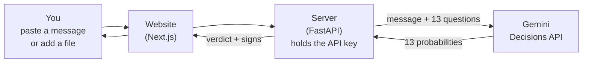
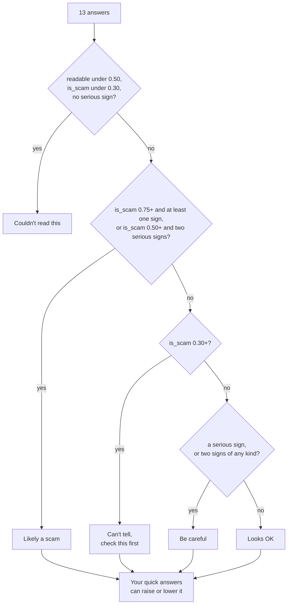

# ScamCheck

**Is this message a scam?** Paste a message, or upload a screenshot, call recording, voice note, video, or PDF. ScamCheck tells you how risky it is, shows the warning signs it found, and gives you the one check that settles it.

It is built for the scams people in India get every day: fake KYC and bank SMS, "digital arrest" calls, courier and customs threats, part-time job tasks, UPI refund tricks, and a "friend" on a new number who needs your card. Messages can be in English or any Indian language, including Hinglish and Telugu typed in English letters.

Powered by the [Gemini Decisions API](https://aistudio.google.com/docs/decisions-api).

---

## Why not just ask a chatbot?

| | Asking a chatbot | ScamCheck |
|---|---|---|
| **The answer** | A paragraph you have to interpret | A clear result, the signs behind it, and what to do next |
| **How it decides** | Hidden inside the model | 13 separate scores, combined by simple rules you can read in [`verdict.py`](backend/app/verdict.py) |
| **Consistency** | The conclusion can change between tries | The same scores always give the same result |
| **A scam that says "this is official and verified"** | Can be talked into agreeing | The model only answers yes/no and multiple-choice questions, and is told that claims inside the message are not proof |
| **Advice and helpline numbers** | Written fresh each time, and can be wrong | Written in advance, pointing only to official help: 1930 and cybercrime.gov.in |
| **When it isn't sure** | Hedges | Says "Can't tell", and gives you the one check that settles it |
| **Privacy** | Your chat may be kept | No account, no database. Your message is checked and then dropped |

---

## How it works



1. **You share what you received.** Paste text, add one file, or both. You can also answer four optional quick questions (see [Your quick answers](#your-quick-answers)).
2. **The server sends one request to the Decisions API:** your message, plus 13 short questions about it.
3. **The API sends back 13 numbers**, one per question, each a probability between 0 and 1. It writes no text.
4. **Plain rules in [`verdict.py`](backend/app/verdict.py) turn those numbers into a result.** No AI is involved in this step, so the same numbers always give the same result.
5. **You see the result:** how risky it is, the warning signs found, the one check to make, and what to do if you've already paid or shared something.

The rest of this page explains each step.

---

## The Decisions API, in short

A normal chatbot API takes a prompt and *writes* an answer. The [Decisions API](https://aistudio.google.com/docs/decisions-api) works differently. You send it some **input** (text, an image, audio, video, or a PDF) and a set of **questions**, and it returns a **calibrated probability** for each one. It generates no text at all: output tokens are always 0, and you pay only for input.

Three properties make it a good fit for scam checking:

- **Every question is answered separately.** Questions can't see each other, so a scammy message can't steer one answer into changing another. Adding or removing a question doesn't change the other answers.
- **All questions run in one request.** The message is read once and counted once for billing, however many questions you ask.
- **The numbers are calibrated.** When the API says 0.80, roughly 80 out of 100 messages scored like that really are "yes". That is why the scores can go straight into `if` rules.

### The question types ScamCheck uses

The API has three question types. ScamCheck uses two of them:

| Type | What it asks | What comes back | Used for |
|---|---|---|---|
| **`noul`** (yes / no) | Does this statement hold? | `noul`: the probability of **yes**, from 0.01 to 0.99. `confidence`: how sure it is of its top answer, `max(noul, 1 − noul)` | 11 questions: is it readable, is it a scam, and the 9 warning signs |
| **`choice`** (pick one) | Which of these options fits best? | `choice`: the top option. `probabilities`: a probability for every option, adding up to 1. `confidence`: the top option's probability | 2 questions: who they claim to be, and what kind of scam it is |
| `score` (rate on a scale) | Where on this ordered scale does it fall? | A weighted average level | Not used |

A `noul` question can include **criteria**: one sentence saying what counts as yes and one saying what counts as no. ScamCheck uses them for the hard cases. For example, a genuine bank alert that says "Not you? Call 1800 258 6161" counts as **no** for "is it a scam?".

A `choice` question **always** spreads its probability across the options, even when none fit. So each one has a catch-all option (`nobody`, `other`), and ScamCheck only shows the answer when the top option is likely enough (see [How the percentages are calculated](#how-the-percentages-are-calculated)).

### What ScamCheck sends

Every check is one call, built in [`main.py`](backend/app/main.py):

```python
result = await client.aio.decisions.create(
    model="gemini-decision-1",
    input=[
        # 1. Fixed instructions: treat the content as untrusted, read any Indian language,
        #    and the list of official websites (every .bank.in and .gov.in address, sbicard.com, ...).
        {"type": "text", "text": INPUT_PREAMBLE},
        # 2. Your quick answers, only if you gave any.
        {"type": "text", "text": CONTEXT_HEADER + '{"sms_from": "phone_number"}'},
        # 3. The text you pasted.
        {"type": "text", "text": USER_NOTE_HEADER + "Rs.1751 spent on your SBI Credit Card ..."},
        # 4. The file you added, if any: image, audio, video, or PDF as base64.
        {"type": "image", "data": "<base64>", "mime_type": "image/png"},
    ],
    questions={
        "is_scam": {
            "type": "noul",
            "instructions": "Is this a fraud or scam attempt meant to trick the person into giving money, ...?",
            "criteria": {"true_description": "...", "false_description": "..."},
        },
        "scam_type": {
            "type": "choice",
            "instructions": "If this is a scam, which kind is it?",
            "criteria": {"bank_kyc": "Fake bank or government notice: ...", "courier_parcel": "...", "...": "..."},
        },
        # ... 13 questions in all, from build_questions() in questions.py
    },
)
```

### What comes back

One answer per question, under the same key. These are the real answers for a fake SBI alert that links to `sbicard-dispute.in` (rounded, and trimmed to the main ones):

```json
{
  "answers": {
    "readable":          { "type": "noul", "noul": 0.95, "confidence": 0.95 },
    "is_scam":           { "type": "noul", "noul": 0.99, "confidence": 0.99 },
    "sign_ask_click":    { "type": "noul", "noul": 0.98, "confidence": 0.98 },
    "sign_ask_secret":   { "type": "noul", "noul": 0.53, "confidence": 0.53 },
    "sign_keep_secret":  { "type": "noul", "noul": 0.01, "confidence": 0.99 },
    "claims_to_be": {
      "type": "choice", "choice": "bank", "confidence": 0.96,
      "probabilities": { "bank": 0.96, "company": 0.02, "nobody": 0.01, "government": 0.00, "family_or_friend": 0.00 }
    },
    "scam_type": {
      "type": "choice", "choice": "bank_kyc", "confidence": 0.82,
      "probabilities": { "bank_kyc": 0.82, "upi_refund": 0.10, "tech_support": 0.04, "other": 0.03, "...": "..." }
    }
  },
  "usage": { "total_input_tokens": 2972, "total_output_tokens": 0 }
}
```

---

## The 13 questions

All questions live in [`questions.py`](backend/app/questions.py). Each one asks exactly one thing, so each answer has a clear meaning and a clear job.

**Part 1: Can it be judged?**

| Key | Type | Question | What it does |
|---|---|---|---|
| `readable` | noul | Is there any message, call, or document here that could be judged? | Below 0.50, and with nothing else worrying, the result is "Couldn't read this" instead of a guess |

**Part 2: Is it a scam, and what kind?**

| Key | Type | Question | What it does |
|---|---|---|---|
| `is_scam` | noul | Is this a fraud or scam attempt? | The main score. It becomes the **Scam risk score** and sets the starting result |
| `scam_type` | choice | Which kind of scam is it? 13 options: fake bank or KYC, courier, digital arrest, fake friend, investment, job or task, loan, lottery, sextortion, fake customer care, UPI refund, electricity bill, other | Names the scam on the result screen and picks the matching safety fact |

**Part 3: Who do they claim to be?**

| Key | Type | Question | What it does |
|---|---|---|---|
| `claims_to_be` | choice | Who does the other person say they are? `bank`, `government`, `company`, `family_or_friend`, `nobody` | Picks "the one check that settles it" (for a bank: call the number on your card; for a friend: call the number saved in your phone), and decides which quick answers apply |

**Part 4: Warning signs.** Nine `noul` questions, shown in three groups on the result screen. A sign counts as **found** at 60% or more. Signs marked **Serious** are things no genuine bank, office, or friend needs from you over a message or call.

| Group | Key | Question | Serious |
|---|---|---|---|
| What they want from you | `ask_secret` | Asks for an OTP, PIN, password, CVV, or card, Aadhaar, or PAN details? | Yes |
| | `ask_money` | Asks for money: a payment, fee, QR scan, UPI request, or gift cards? | Yes |
| | `ask_install` | Asks you to install AnyDesk, TeamViewer, an APK, or share your screen? | Yes |
| | `ask_card_info` | Asks which cards you have, your limits, or to turn on online payments? | Yes |
| | `ask_click` | Asks you to open a short, misspelled, or lookalike link (not on the official website list)? | |
| How they push you | `rush_or_threat` | Rushes you, or threatens arrest, a blocked account, or a penalty? | |
| | `keep_secret` | Tells you to keep it secret, or stay on a video call? | Yes |
| | `too_good` | Promises a prize, refund, cashback, easy job, or high returns? | |
| Who they say they are | `cant_verify` | Claims to be someone you know, with a reason to doubt it (new number, no history)? | |

### Why 13 small questions instead of one big one

- **Every result can explain itself.** "Likely a scam" always comes with the signs behind it, such as "Asks you to open a link or download a file, 98%". One "is this a scam?" score can't tell you *why*.
- **It's hard to argue with.** A scam can write "this is an official, verified message" into itself. That might sway one score, but it can't sway nine separate yes/no checks on what the message actually asks for.
- **The rules stay simple.** Decisions like "a serious sign was found" or "it claims to be a bank and came from a phone number" are plain `if` statements on these answers.
- **It costs the same.** The message is billed once, whatever the number of questions.

### Keeping genuine messages from being flagged

The fixed instructions sent with every check include a list of **official websites**, defined in `OFFICIAL_ENDINGS` and `OFFICIAL_WEBSITES` in [`questions.py`](backend/app/questions.py):

- Any address ending in **`.bank.in`**. Since 31 October 2025 RBI requires every bank to use it, and only licensed banks can register one. The current addresses are on [RBI's list](https://rbi.org.in/scripts/banklinks.aspx).
- Any address ending in **`.gov.in`**, **`.nic.in`**, or **`.sbi`**.
- Older bank addresses still used in SMS (`hdfcbank.com`, `onlinesbi.sbi`, ...), card and payment sites (`sbicard.com`, `paytm.com`, `npci.org.in`, ...), and a few shopping and telecom sites.

An address counts only if it **ends** with one of these. `icici.bank.in` is official. `icici.bank.in.secure-verify.com` and `sbicard-dispute.in` are not. An official link doesn't clear the rest of the message: a real `hdfc.bank.in` link alongside "share the OTP with our executive" is still a scam.

---

## From 13 numbers to one result

The rules in [`verdict.py`](backend/app/verdict.py) run in this order:



"Likely a scam" always needs at least one warning sign to show. If `is_scam` is high but no sign was found, which happens with some genuine bank alerts, the result is "Can't tell". That screen tells you to check using a number you already have, which is the right advice either way.

### Your quick answers

The model can't see some things: who sent the SMS, or whether you've already called to check. The four optional questions in the form fill that gap. They change the **result**, never the risk score, and the result screen always says why.

| You answered | When | Change |
|---|---|---|
| SMS came from **a phone number** | It claims to be a bank or government office | "Can't tell" or "Be careful" → **Likely a scam**. "Looks OK" → **Be careful**. Banks send SMS from a sender name like AX-HDFCBK, never from a 10-digit number |
| SMS came from **a sender name** like AX-HDFCBK | It claims to be a bank or government office, and no sign was found | "Can't tell" → **Looks OK** |
| Someone else **passed this request on** | It asks for money, an OTP, or card details | "Can't tell" or "Be careful" → **Likely a scam** |
| The number is **not saved** in your phone | It claims to be someone you know and asks for money, an OTP, or card details | "Can't tell" or "Be careful" → **Likely a scam** |
| You **called them** on a number you already had | At most one serious sign, and `is_scam` under 0.90 | "Likely a scam" → **Be careful**. "Can't tell" → **Looks OK** |

---

## How the percentages are calculated

Every percentage on the result screen is one API probability × 100, rounded. Nothing is added up or averaged.

| On screen | Comes from | Calculation |
|---|---|---|
| **Scam risk score** (for example 99/100) | `is_scam` | `round(is_scam × 100)` |
| The label beside it | The result | "Critical risk" when the result is "Likely a scam" and the score is 90 or more. Otherwise "High risk", "Caution", "Unsure", or "Low risk" to match the result |
| Each warning sign's bar (for example 98%) | That sign's `noul` | `round(noul × 100)`. Counts as **found** at 60% or more |
| "Says they're your bank" | `claims_to_be` | Shown when its `confidence` is 50% or more |
| The scam type, such as "Fake bank, KYC, or PAN message" | `scam_type` | Shown when its `confidence` is 40% or more, the result is "Likely a scam" or "Be careful", and the type isn't `other` |

Things worth knowing:

- **The score runs from 1 to 99, never 0 or 100.** The API keeps yes/no probabilities between 0.01 and 0.99, so **99 is the highest possible score**. It means the model is as sure as it can be, not 100% certain.
- **The score is the model's view of the message alone.** Your quick answers and the rules can change the result without changing the score. A genuine bank alert can show a high score with "Can't tell" (no warning sign was found), and the result screen explains why.
- **The thresholds (0.75, 0.50, 0.30, 60%, ...) are starting values,** set at the top of [`verdict.py`](backend/app/verdict.py) and tuned against real messages.

### Worked example

The fake SBI alert from [What comes back](#what-comes-back):

> Rs.2000 spent on your SBI Credit Card ending 1234 at FlipkartInternetPriv on 21/11/26 Trxn. Not Done by you? Report at https://sbicard-dispute.in/report

1. `readable` is 0.95, so there is something to judge.
2. `is_scam` is 0.99, which is 0.75 or more, and `ask_click` is 0.98, which is 60% or more, so one sign was found. The result is **Likely a scam**.
3. The scam risk score is `round(0.99 × 100)` = **99/100**. That is 90 or more with a "Likely a scam" result, so the label is **Critical risk**.
4. `claims_to_be` is `bank` at 0.96, which is 50% or more, so the screen shows **"Says they're your bank or a payment app"**. Because of that, the one check is: *open your bank's own app, or call the number on the back of your card.*
5. `scam_type` is `bank_kyc` at 0.82, which is 40% or more, so the screen shows **"Fake bank, KYC, or PAN message"**.
6. `ask_secret` is 0.53, below 60%, so it is listed under "Other checks" rather than as a sign found.

The genuine SBI alert, which links to the real `https://sbicard.com/Dispute`, scores `is_scam` 0.04 with no signs found: **Looks OK**, 4/100.

---

## Project layout

```
backend/            FastAPI server: holds the API key and calls the Decisions API
  app/main.py       The /api/check endpoint: reads the upload, builds the request, calls the API
  app/questions.py  The 13 questions, the fixed instructions, and the official website list
  app/verdict.py    The rules that turn 13 probabilities into one result
  app/media.py      Checks that an uploaded file really is the type its name says
  app/ratelimit.py  Per-visitor limits, so a public site can't run up your bill
web/                Next.js website
  app/checker.tsx   The form: message, file, and quick questions
  app/result.tsx    The result screen: verdict, score, signs, and next steps
```

---

## Run it locally

You need Python 3.12+, Node 20+, and a Gemini API key from <https://aistudio.google.com/api-keys>.

**Server**

```bash
cd backend
python -m venv .venv
.venv\Scripts\activate            # macOS/Linux: source .venv/bin/activate
pip install -r requirements.txt
copy .env.example .env            # macOS/Linux: cp .env.example .env
# put your key in .env: GEMINI_API_KEY=...
uvicorn app.main:app --port 8000
```

**Website** (in a second terminal)

```bash
cd web
npm install
npm run dev
```

Open <http://localhost:3000>.

The API key stays on the server and never reaches the browser. Checks are rate limited, so set the limits in `backend/.env` to what you're willing to spend.

---

## Already paid or shared something?

Call **1930** (National Cyber Crime Helpline) straight away, or report it at **[cybercrime.gov.in](https://cybercrime.gov.in)**.
