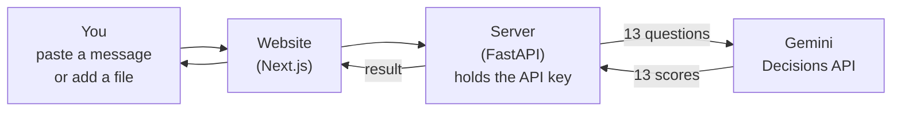
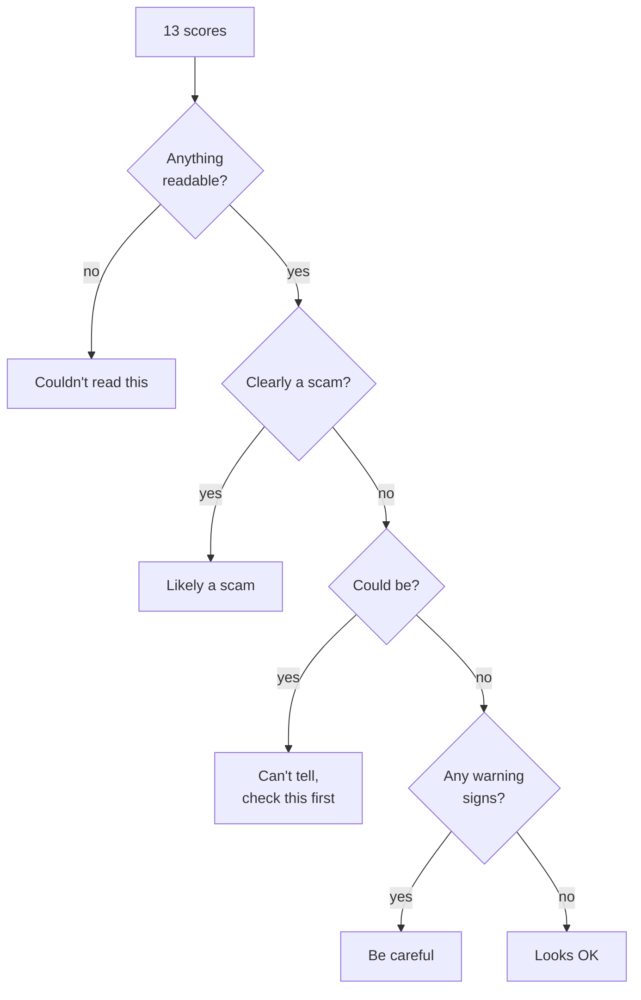

# ScamCheck

**Is this message a scam?** Paste a message, or upload a screenshot, call recording, voice note, video, or PDF. ScamCheck tells you how risky it is, shows the warning signs it found, and gives you the one check that settles it.

It is built for the scams people in India get every day: fake KYC and bank SMS, "digital arrest" calls, courier and customs threats, part-time job tasks, UPI refund tricks, and a "friend" on a new number who needs your card. Messages can be in English or any Indian language, including Hinglish and Telugu typed in English letters.

Powered by the [Gemini Decisions API](https://aistudio.google.com/docs/decisions-api).

---

## Why not just ask a chatbot?

| | Asking a chatbot | ScamCheck |
|---|---|---|
| **The answer** | A paragraph you have to interpret | A clear result, the signs behind it, and what to do next |
| **How it decides** | Hidden inside the model | 13 separate scores, combined by simple rules you can read in [`verdict.py`](backend/app/verdict.py) |
| **Consistency** | The conclusion can change between tries | The same scores always give the same result |
| **A scam that says "this is official and verified"** | Can be talked into agreeing | The model only answers yes/no and multiple-choice questions, and is told that claims inside the message are not proof |
| **Advice and helpline numbers** | Written fresh each time, and can be wrong | Written in advance, pointing only to official help: 1930 and cybercrime.gov.in |
| **When it isn't sure** | Hedges | Says "Can't tell", and gives you the one check that settles it |
| **Privacy** | Your chat may be kept | No account, no database. Your message is checked and then dropped |

---

## How it works



1. **You share what you received.** Paste text, add one file, or both. You can also answer three quick questions: Is the number saved in your phone? Did someone else pass this on? Did you call them back to confirm?
2. **Gemini answers 13 questions about it** in one request ([`questions.py`](backend/app/questions.py)):
   - **Can it be judged?** Is there a message here at all?
   - **Is it a scam, and what kind?** KYC, digital arrest, courier, fake friend, job, investment, loan, lottery, UPI refund, bill, sextortion, fake customer care.
   - **Who do they claim to be?** Bank, government, company, someone you know, or nobody.
   - **What do they want from you?** OTP or PIN, money, installing an app, your card details, opening a link.
   - **How do they push you?** Rushing or threats, secrecy, too good to be true.
   - **Can you trust who they say they are?** A new number, or no proof it's really them.
3. **Simple rules turn the scores into a result.** No AI is involved in this step.



4. **Your quick answers adjust the result.** For example, a request for money passed on by someone else is raised to "Likely a scam". If you already confirmed by calling a number you trust, the result is lowered. The result always tells you why.
5. **You see what to do next:** the one check to make, and the steps to take if you've already paid or shared something.

"Looks OK" means no warning signs matched. It is not a guarantee.

---

## Run it locally

You need Python 3.12+, Node 20+, and a Gemini API key from <https://aistudio.google.com/api-keys>.

**Server**

```bash
cd backend
python -m venv .venv
.venv\Scripts\activate            # macOS/Linux: source .venv/bin/activate
pip install -r requirements.txt
copy .env.example .env            # macOS/Linux: cp .env.example .env
# put your key in .env: GEMINI_API_KEY=...
uvicorn app.main:app --port 8000
```

**Website** (in a second terminal)

```bash
cd web
npm install
npm run dev
```

Open <http://localhost:3000>.

The API key stays on the server and never reaches the browser. Checks are rate limited, so set the limits in `backend/.env` to what you're willing to spend.

---

## Already paid or shared something?

Call **1930** (National Cyber Crime Helpline) straight away, or report it at **[cybercrime.gov.in](https://cybercrime.gov.in)**.
